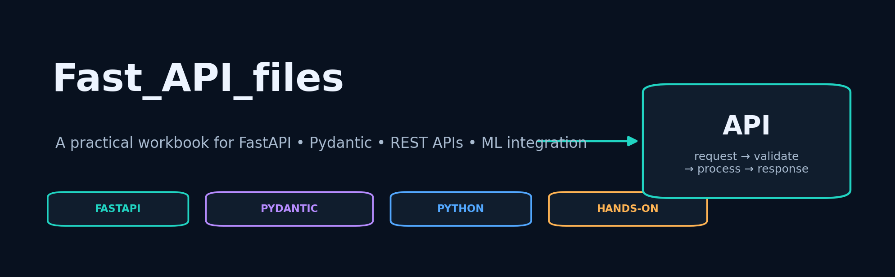
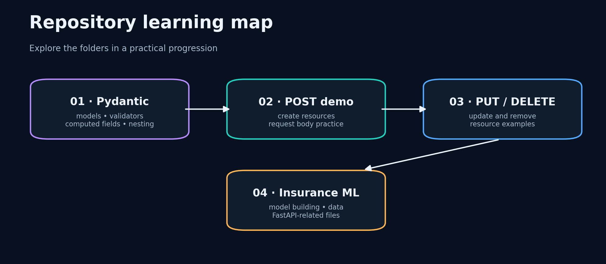
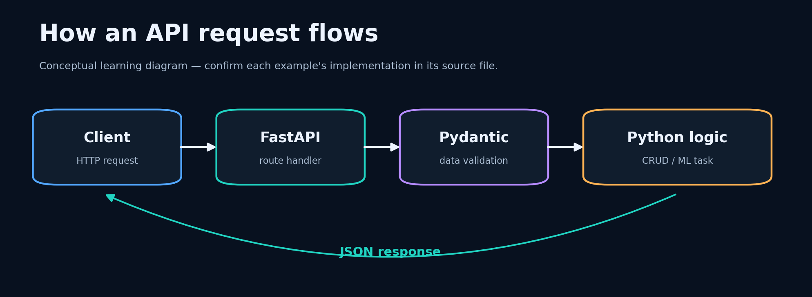

::: {align="center"}


[](https://github.com/Zylor07/Fast_API_files)


**A hands-on code workbook for learning FastAPI, Pydantic, REST API
operations, and machine-learning API workflows.**
:::

------------------------------------------------------------------------

## Contents

-   [Overview](#overview)
-   [Topics covered](#topics-covered)
-   [Repository structure](#repository-structure)
-   [Quick links to code](#quick-links-to-code)
-   [Learning path](#learning-path)
-   [Getting started](#getting-started)
-   [Running examples](#running-examples)
-   [Visual guides](#visual-guides)
-   [Notes](#notes)
-   [Author](#author)

## Overview

This repository collects small, commented Python examples intended to
make API development concepts easier to study. The visible project is
grouped into Pydantic exercises, HTTP-method demonstrations, and an
insurance machine-learning example.

Use the folders as a workbook: open a file, read its comments, run the
example in its own environment where applicable, and modify it to test
your understanding.

## Topics covered

  -----------------------------------------------------------------------
  Area                                What to explore
  ----------------------------------- -----------------------------------
  FastAPI                             API application files and example
                                      project structure

  Pydantic                            `BaseModel`, typed fields,
                                      validation, nested models,
                                      serialization

  Field validation                    Custom field-level validation
                                      examples

  Model validation                    Validation across model fields

  Computed fields                     Derived values on models

  REST operations                     POST, PUT/update, and DELETE
                                      demonstration folders

  ML integration                      Insurance dataset, notebook, model
                                      artifact, and supporting app files
  -----------------------------------------------------------------------

## Repository structure

``` text
Fast_API_files/
└── patients/
    ├── insurance_model_building/
    │   ├── app.py
    │   ├── frontend.py
    │   ├── fastapi_ml_model.ipynb
    │   ├── insurance.csv
    │   ├── model_insurance.pkl
    │   ├── requirements.txt
    │   └── csv_feature_managing.png
    ├── post_method_demo/
    │   └── main.py
    ├── pydantic_codes/
    │   ├── 1_pydantic_why.py
    │   ├── 1_1pydantic_why.py
    │   ├── 1_2pydantic_why.py
    │   ├── 1_3pydantic.py
    │   ├── 2_field_validator.py
    │   ├── 3_model_validator.py
    │   ├── 4_computed_fields.py
    │   ├── 5_nested_models.py
    │   └── 6_serialization.py
    ├── update_method_or_put_with_delete_demo/
    │   ├── main.py
    │   ├── demo_patients-v2.json
    │   └── requirements.txt
    ├── demo_patients-v2.json
    └── main.py
```

## Quick links to code

### Main patient examples

  -------------------------------------------------------------------------------------------------------------------------------------------------
  Resource                                                                                                      Description
  ------------------------------------------------------------------------------------------------------------- -----------------------------------
  [main.py](https://github.com/Zylor07/Fast_API_files/blob/main/patients/main.py)                               Main Python example in the
                                                                                                                `patients` folder

  [demo_patients-v2.json](https://github.com/Zylor07/Fast_API_files/blob/main/patients/demo_patients-v2.json)   Patient demo JSON data

  [patients](https://github.com/Zylor07/Fast_API_files/tree/main/patients)                                      Browse all patient examples
  -------------------------------------------------------------------------------------------------------------------------------------------------

### Pydantic learning files

Open these in order to follow the visible numbered exercises.

  --------------------------------------------------------------------------------------------------------------------------------------------------------------
  File                                                                                                                       Focus
  -------------------------------------------------------------------------------------------------------------------------- -----------------------------------
  [1_pydantic_why.py](https://github.com/Zylor07/Fast_API_files/blob/main/patients/pydantic_codes/1_pydantic_why.py)         Why Pydantic / introductory example

  [1_1pydantic_why.py](https://github.com/Zylor07/Fast_API_files/blob/main/patients/pydantic_codes/1_1pydantic_why.py)       Introductory Pydantic example

  [1_2pydantic_why.py](https://github.com/Zylor07/Fast_API_files/blob/main/patients/pydantic_codes/1_2pydantic_why.py)       Introductory Pydantic example

  [1_3pydantic.py](https://github.com/Zylor07/Fast_API_files/blob/main/patients/pydantic_codes/1_3pydantic.py)               Pydantic example

  [2_field_validator.py](https://github.com/Zylor07/Fast_API_files/blob/main/patients/pydantic_codes/2_field_validator.py)   Field validators

  [3_model_validator.py](https://github.com/Zylor07/Fast_API_files/blob/main/patients/pydantic_codes/3_model_validator.py)   Model validators

  [4_computed_fields.py](https://github.com/Zylor07/Fast_API_files/blob/main/patients/pydantic_codes/4_computed_fields.py)   Computed fields

  [5_nested_models.py](https://github.com/Zylor07/Fast_API_files/blob/main/patients/pydantic_codes/5_nested_models.py)       Nested models

  [6_serialization.py](https://github.com/Zylor07/Fast_API_files/blob/main/patients/pydantic_codes/6_serialization.py)       Serialization

  [patients/pydantic_codes](https://github.com/Zylor07/Fast_API_files/tree/main/patients/pydantic_codes)                     Browse the Pydantic folder
  --------------------------------------------------------------------------------------------------------------------------------------------------------------

### REST API method demonstrations

  ---------------------------------------------------------------------------------------------------------------------------------------------------------------------------------------
  Folder / file                                                                                                                                       Description
  --------------------------------------------------------------------------------------------------------------------------------------------------- -----------------------------------
  [main.py](https://github.com/Zylor07/Fast_API_files/blob/main/patients/post_method_demo/main.py)                                                    POST-method demo

  [main.py](https://github.com/Zylor07/Fast_API_files/blob/main/patients/update_method_or_put_with_delete_demo/main.py)                               Update / PUT / DELETE demo

  [demo_patients-v2.json](https://github.com/Zylor07/Fast_API_files/blob/main/patients/update_method_or_put_with_delete_demo/demo_patients-v2.json)   JSON data used by the update/delete
                                                                                                                                                      demo

  [requirements.txt](https://github.com/Zylor07/Fast_API_files/blob/main/patients/update_method_or_put_with_delete_demo/requirements.txt)             Dependencies for this demo
  ---------------------------------------------------------------------------------------------------------------------------------------------------------------------------------------

### Insurance machine-learning example

  --------------------------------------------------------------------------------------------------------------------------------------------------------------------------------
  Resource                                                                                                                                     Description
  -------------------------------------------------------------------------------------------------------------------------------------------- -----------------------------------
  [app.py](https://github.com/Zylor07/Fast_API_files/blob/main/patients/insurance_model_building/app.py)                                       Application code

  [frontend.py](https://github.com/Zylor07/Fast_API_files/blob/main/patients/insurance_model_building/frontend.py)                             Frontend code

  [fastapi_ml_model.ipynb](https://github.com/Zylor07/Fast_API_files/blob/main/patients/insurance_model_building/fastapi_ml_model.ipynb)       ML notebook

  [insurance.csv](https://github.com/Zylor07/Fast_API_files/blob/main/patients/insurance_model_building/insurance.csv)                         Insurance dataset

  [model_insurance.pkl](https://github.com/Zylor07/Fast_API_files/blob/main/patients/insurance_model_building/model_insurance.pkl)             Serialized model artifact

  [requirements.txt](https://github.com/Zylor07/Fast_API_files/blob/main/patients/insurance_model_building/requirements.txt)                   Example dependencies

  [csv_feature_managing.png](https://github.com/Zylor07/Fast_API_files/blob/main/patients/insurance_model_building/csv_feature_managing.png)   CSV feature-management visual

  [patients/insurance_model_building](https://github.com/Zylor07/Fast_API_files/tree/main/patients/insurance_model_building)                   Browse the insurance project folder
  --------------------------------------------------------------------------------------------------------------------------------------------------------------------------------

## Learning path



Suggested order:

1.  **Pydantic basics:** start with the numbered files in
    `pydantic_codes/`.
2.  **Validation:** study field validators, model validators, computed
    fields, and nested models.
3.  **POST:** explore the POST demonstration.
4.  **Update and delete:** move to the PUT/update and DELETE
    demonstration.
5.  **ML workflow:** explore the insurance dataset, notebook, model
    artifact, and app files.

## Getting started

### 1. Clone the repository

``` bash
git clone https://github.com/Zylor07/Fast_API_files.git
cd Fast_API_files
```

### 2. Create a virtual environment

**macOS / Linux**

``` bash
python3 -m venv .venv
source .venv/bin/activate
```

**Windows PowerShell**

``` powershell
python -m venv .venv
.venv\\Scripts\\Activate.ps1
```

### 3. Install dependencies for the example you want to run

The repository contains requirements files inside specific example
folders. For the insurance project:

``` bash
cd patients/insurance_model_building
pip install -r requirements.txt
```

For the update / PUT / DELETE demo:

``` bash
cd patients/update_method_or_put_with_delete_demo
pip install -r requirements.txt
```

If an example folder does not contain a requirements file, check its
imports and install the required packages in your active virtual
environment.

## Running examples

Run a standalone Python example with:

``` bash
python filename.py
```

For a FastAPI application, the common Uvicorn pattern is:

``` bash
uvicorn module_name:app --reload
```

Replace `module_name` and `app` with the actual Python module and
FastAPI instance names used in the selected file. Run the command from
that file's directory, and check the source before assuming a particular
route or startup command.

## Visual guides

### Request lifecycle



This is a conceptual diagram to help organize the learning topics. It is
not a claim that every example implements every stage in exactly this
way.

## Notes

-   The file tree and direct links above reflect the repository layout
    visible in the project screenshots. If files are renamed or moved,
    update the links accordingly.
-   `model_insurance.pkl` is a pickle artifact. Only load pickle files
    from a source you trust.
-   Avoid committing local virtual environments, `__pycache__/`,
    `.DS_Store`, or other machine-specific files. Consider adding a
    `.gitignore`.
-   Check each example's source code for its exact routes, schemas,
    dependency versions, and run configuration.

## Author

**Pritam Chakraborty**\
GitHub: [@Zylor07](https://github.com/Zylor07)

------------------------------------------------------------------------

::: {align="center"}
If this repository helps you learn, consider giving it a ⭐ on GitHub.
:::
