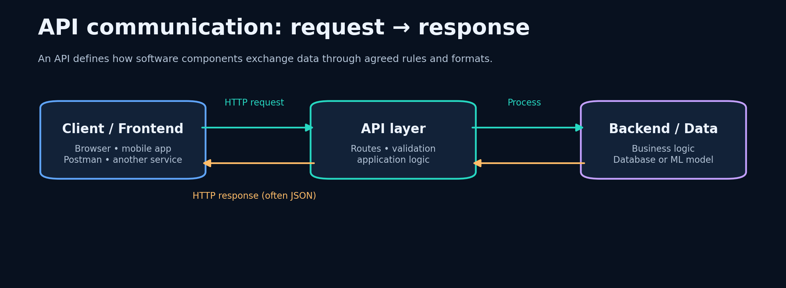
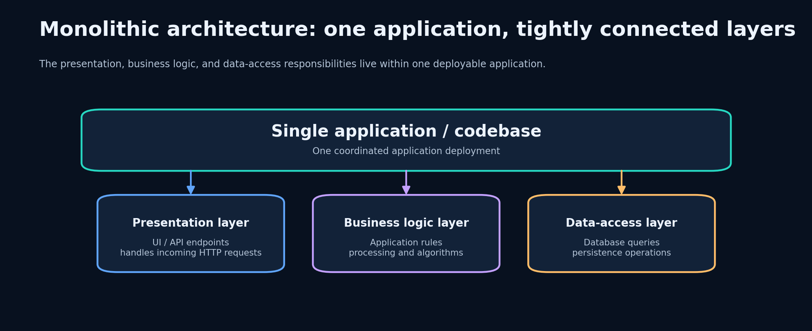
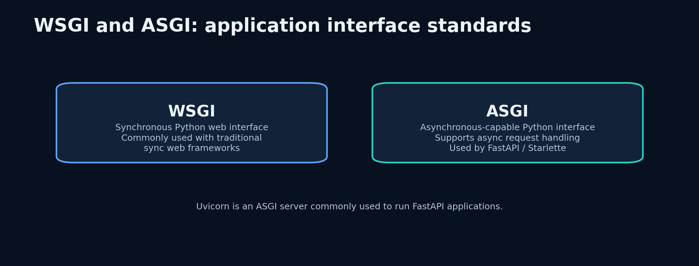
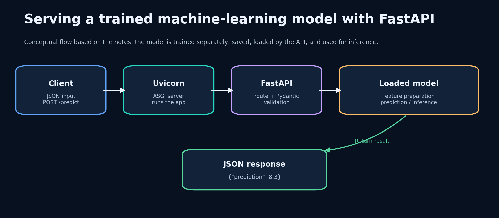

# FastAPI & API Development — Learning Notes

These notes reorganize the handwritten study material into a readable reference. The examples and learning sequence follow the notebook topics. Short clarifications are included where a term needs precision.

## 1. What is an API?

API stands for **Application Programming Interface**. It is a defined way for software components to communicate. An API specifies the available operations, expected inputs, outputs, and rules for interaction.

A common web-application example:

1. A client (browser, mobile app, or another service) sends an HTTP request.
2. The backend receives and processes the request.
3. The backend returns an HTTP response, often containing JSON.



**Analogy from the notes:** the customer interacts with a waiter, and the waiter communicates with the kitchen. The waiter acts as an intermediary between the customer and the kitchen.

## 2. Monolithic architecture

A **monolithic application** is built and deployed as one application. Its components are typically maintained in one codebase and run as a coordinated unit.

The notebook identifies three logical layers:

1. **Presentation layer:** user interface or API endpoints that receive HTTP requests.
2. **Business logic layer:** core application rules, data processing, and algorithms.
3. **Data-access layer:** code that communicates with the underlying database.



### Advantages noted in the notebook

- Simple initial development.
- Straightforward deployment.
- Easier to debug and test in smaller applications.
- Potentially good performance for in-process calls because components do not need network communication with each other.

### Disadvantages noted in the notebook

- **Tight coupling:** as the codebase grows, boundaries between modules can become unclear. A defect in one area may affect unrelated features.
- **Insufficient independent scaling:** if one feature needs more resources, it may be necessary to scale the whole application.
- **Deployment friction:** a small change may require rebuilding, testing, and redeploying the whole application.
- **Technology lock-in:** using one primary stack across the application can make adopting a different technology for one component harder.

These are common trade-offs, not absolute rules. A well-structured monolith can still be maintainable and effective.

## 3. FastAPI, Starlette, Uvicorn, and Pydantic

- **FastAPI:** a Python web framework for building APIs.
- **Starlette:** the ASGI toolkit/framework foundation used by FastAPI for web capabilities.
- **Pydantic:** validates and parses data using Python type annotations and model definitions.
- **Uvicorn:** an ASGI server commonly used to run a FastAPI application.

A useful distinction:

- FastAPI defines the API application and its routes.
- Uvicorn runs the ASGI application and accepts incoming connections.
- Pydantic validates structured input and output data.
- Starlette provides core ASGI web functionality beneath FastAPI.

### WSGI vs ASGI

- **WSGI** is the traditional synchronous Python web-server interface.
- **ASGI** is the newer asynchronous-capable interface. It supports async applications and protocols such as WebSockets.

FastAPI is an ASGI framework; Uvicorn is a common ASGI server for it.



## 4. Create and run a basic FastAPI application

### Create a virtual environment

macOS / Linux:

```bash
python3 -m venv .venv
source .venv/bin/activate
```

Windows PowerShell:

```powershell
python -m venv .venv
.venv\Scripts\Activate.ps1
```

### Install packages

```bash
pip install fastapi uvicorn pydantic
```

### Minimal `main.py`

```python
from fastapi import FastAPI

app = FastAPI()

@app.get("/")
def hello():
    return {"message": "Hello, world"}
```

### Run the application

```bash
uvicorn main:app --reload
```

Command breakdown:

- `main` is the Python module (`main.py`).
- `app` is the FastAPI instance inside that module.
- `--reload` restarts the development server when code changes. Use it for local development, not as a production process manager.

Open `http://127.0.0.1:8000/` to view the root endpoint. FastAPI also provides interactive API documentation at `/docs` by default.

## 5. HTTP methods and CRUD

The notebook connects HTTP verbs with CRUD operations:

| HTTP method | CRUD idea | Typical purpose |
|---|---|---|
| `GET` | Read | Retrieve a resource |
| `POST` | Create | Submit data to create a resource or trigger processing |
| `PUT` | Update / replace | Replace a resource representation |
| `DELETE` | Delete | Remove a resource |

A partial update is commonly represented by `PATCH`, although the notebook's method list focuses on GET, POST, PUT, and DELETE.

## 6. Path parameters and query parameters

### Path parameters

Path parameters are dynamic parts of a URL used to identify a particular resource.

Example:

```text
GET /patients/42
```

Here, `42` identifies a patient.

FastAPI example:

```python
from fastapi import FastAPI

app = FastAPI()

@app.get("/patients/{patient_id}")
def get_patient(patient_id: int):
    return {"patient_id": patient_id}
```

The `Path()` helper can add validation constraints and documentation metadata to a path parameter.

### Query parameters

Query parameters are key-value pairs after `?` in a URL. They are useful for filtering, sorting, searching, and pagination.

Example:

```text
GET /patients?city=Delhi&sort_by=age
```

- `city=Delhi` can be used as a filter.
- `sort_by=age` can specify a sort order.

FastAPI example:

```python
from fastapi import FastAPI

app = FastAPI()

@app.get("/patients")
def list_patients(city: str | None = None, sort_by: str = "name"):
    return {"city": city, "sort_by": sort_by}
```

The `Query()` helper can define constraints and metadata for query parameters.

## 7. HTTP status codes

HTTP status codes are three-digit values returned with an HTTP response.

| Range / code | Meaning | Typical example |
|---|---|---|
| `2xx` | Success | Request processed successfully |
| `200 OK` | Success | A read or operation returned a response |
| `201 Created` | Resource created | A POST created a resource |
| `204 No Content` | Success, no response body | A DELETE completed |
| `3xx` | Redirection | Client needs to follow a redirect |
| `4xx` | Client error | Invalid input or missing resource |
| `400 Bad Request` | Invalid request | Request cannot be processed as sent |
| `401 Unauthorized` | Authentication required/invalid | Login or valid credentials needed |
| `403 Forbidden` | Not permitted | Caller lacks permission |
| `404 Not Found` | Resource not found | Requested patient ID does not exist |
| `5xx` | Server error | Server failed to fulfil a valid request |
| `500 Internal Server Error` | Server-side failure | Unexpected application error |
| `502 Bad Gateway` | Upstream failure | Gateway received an invalid upstream response |
| `503 Service Unavailable` | Temporarily unavailable | Server is down or overloaded |

Note: `401` means the request lacks valid authentication; `403` means the server understood the request but refuses authorization.

## 8. HTTPException in FastAPI

FastAPI's `HTTPException` lets an endpoint stop processing and return an HTTP error response with a chosen status code and detail.

```python
from fastapi import FastAPI, HTTPException

app = FastAPI()

patients = {
    1: {"name": "Asha"},
    2: {"name": "Ravi"},
}

@app.get("/patients/{patient_id}")
def get_patient(patient_id: int):
    if patient_id not in patients:
        raise HTTPException(
            status_code=404,
            detail="Patient not found"
        )

    return patients[patient_id]
```

Instead of returning an ordinary success-shaped JSON object for an error, the exception produces the selected HTTP status code.

## 9. Pydantic models and validation

A Pydantic model describes the expected structure of data. It declares fields, their Python types, and optional validation constraints.

Typical workflow:

1. Define a model class based on `BaseModel`.
2. Create an instance using incoming data (often a dictionary or parsed JSON).
3. Pydantic validates the values and parses supported types.
4. If the data does not satisfy the model, validation raises an error.
5. Use the validated model object in the application.

Example:

```python
from pydantic import BaseModel, Field

class Patient(BaseModel):
    name: str
    age: int = Field(gt=0)
    weight: float = Field(gt=0)

patient = Patient(
    name="Pritam",
    age=23,
    weight=72.0
)

print(patient.name)
```

### Pydantic topics in the repository

- `BaseModel` and typed fields.
- `Field()` constraints and metadata.
- Field validators.
- Model validators.
- Computed fields.
- Nested models.
- Serialization.

The repository's numbered examples under `patients/pydantic_codes/` are the practical companion to this section.

## 10. Serving a machine-learning model through FastAPI

The notebook describes a workflow in which a trained ML model is saved to a file (for example, a `.pkl` artifact), loaded by an API application, and used to make predictions from client input.



### Conceptual request flow

1. A client sends an HTTP POST request to a prediction endpoint such as `/predict`.
2. The request body contains input features, usually as JSON.
3. FastAPI receives the request and validates its structure.
4. The application prepares the feature values in the order and format expected by the model.
5. The already-loaded model performs inference.
6. The API returns the prediction in a JSON response.

Example request body:

```json
{
  "feature_1": 5.2,
  "feature_2": 3.1
}
```

Example response:

```json
{
  "prediction": 8.3
}
```

These values are illustrative, following the notebook example. Actual feature names, preprocessing, endpoint names, and prediction formats must match the model and application code.

### Important implementation practices

- Load the model once when the application starts, rather than reloading it for every request.
- Apply the same preprocessing at inference time that was used during training.
- Validate feature names, types, ranges, and ordering.
- Keep model artifacts and dependencies version-compatible.
- Only load trusted pickle files: unpickling an untrusted file can execute malicious code.

## 11. Deployment concept

The notes introduce deploying a FastAPI application and its trained model on AWS. At a high level, a deployment needs:

- The FastAPI application and its routes.
- An ASGI server such as Uvicorn.
- The trained model artifact and required preprocessing code.
- Python dependencies and runtime configuration.
- Hosting infrastructure and a way to expose the service to clients.

The exact AWS service, network configuration, security controls, and deployment steps depend on the chosen architecture; they are not specified in the notebook pages.

## 12. Suggested revision checklist

- [ ] Explain API, client, frontend, backend, request, and response.
- [ ] Draw the three layers of a monolithic application.
- [ ] Compare WSGI and ASGI.
- [ ] Explain the roles of FastAPI, Starlette, Uvicorn, and Pydantic.
- [ ] Create and run a minimal FastAPI app.
- [ ] Explain GET, POST, PUT, and DELETE.
- [ ] Differentiate path parameters and query parameters.
- [ ] Recognize common 2xx, 3xx, 4xx, and 5xx status codes.
- [ ] Raise an `HTTPException` for a missing resource.
- [ ] Define a Pydantic model and validate input.
- [ ] Explain the request-to-prediction flow for an ML model.
- [ ] Describe the main components needed for deployment.

## Official references

- [FastAPI documentation](https://fastapi.tiangolo.com/)
- [Pydantic documentation](https://docs.pydantic.dev/)
- [Starlette documentation](https://www.starlette.io/)
- [Uvicorn documentation](https://www.uvicorn.org/)
- [Python virtual environments](https://docs.python.org/3/library/venv.html)
